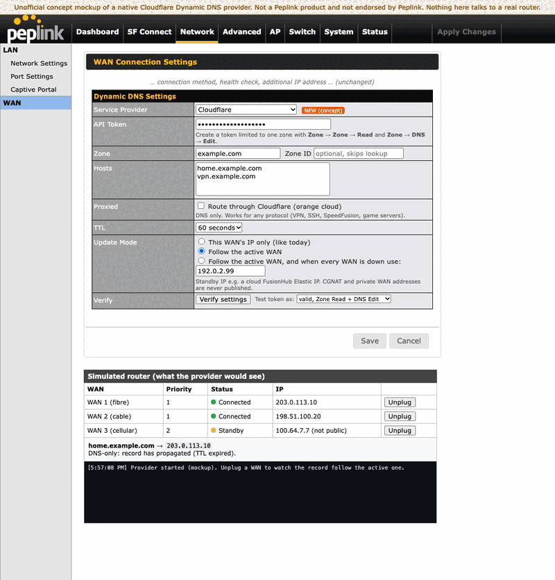

# Cloudflare Dynamic DNS for Peplink (concept + working prototype)

[](https://github.com/SoundMatt/cfpl/actions/workflows/ci.yml)
**[Live mockup](https://soundmatt.github.io/cfpl/)**



A feature request made runnable: a **WAN-aware Cloudflare DDNS provider** for Peplink routers.
Today the built-in Dynamic DNS list has no Cloudflare option, and per-WAN DDNS can't follow
*whichever WAN is currently active* or fall back to a cloud standby (e.g. FusionHub) when every WAN is down.

> Unofficial. Not affiliated with or endorsed by Peplink. The UI mockup reuses Peplink's own
> stylesheets (see LICENSE note) to show how the feature could look in Web Admin.

## Try it in 30 seconds (no router, no Cloudflare account)

```sh
docker compose --profile demo up --build
```

Open <http://localhost:8080>. The page is the Dynamic DNS panel with a new **Cloudflare** provider, plus a
simulated router: unplug WANs and watch the record follow the active one. The `ddns-demo` container runs the
real daemon against fake Peplink/Cloudflare APIs; control the fake router from a shell:

```sh
curl -X POST 'localhost:8080/demo/wan?id=1&state=down'   # unplug WAN 1
curl localhost:8080/demo/state                           # WANs + current DNS records
docker compose logs -f ddns-demo
```

## Run it against your real router

```sh
cp .env.example .env     # fill in router login, Cloudflare token, zone, hostnames
docker compose --profile live run --rm ddns python ddns.py --verify   # three-step check
docker compose --profile live up -d --build                          # DRY_RUN=1 by default
```

Token scope: **Zone → Zone → Read** and **Zone → DNS → Edit**, limited to one zone.
(The "Edit zone DNS" template alone may not allow the zone lookup; set `CF_ZONE_ID` to skip it.)

## Tests and measurements

```sh
python -m unittest discover -s tests -v          # logic + daemon against the mock APIs
python3 scripts/e2e_demo.py                      # against the running demo containers
python3 scripts/token_matrix.py                  # which token scopes pass which Verify step (real Cloudflare)
python3 scripts/failover_timing.py --new-ip ...  # unplug a WAN; time record / DNS / HTTP (real router)
```

`token_matrix.py` and `failover_timing.py` only read from Cloudflare. Results for a real setup go in `docs/results.md`.

## What it does

- **Verify** in three steps, each reporting its own result: token active, zone visible (ID cached),
  records readable. Failures name the likely missing permission.
- **Follow active WAN**: highest-priority connected WAN with a publishable IP; falls back to `STANDBY_IP`.
- Never publishes CGNAT (`100.64/10`), private or other non-global addresses.
- Debounces flapping (`DEBOUNCE_POLLS`) and only calls Cloudflare when the answer changes.
- **Proxied** option: TTL becomes Auto, with a warning that only HTTP/HTTPS is proxied.
- A/AAAA chosen by address family; several hostnames per token; `host=2` pins a host to WAN 2.
- **Periodic reconcile** (`RECONCILE_SECONDS`, default 30 min) re-reads Cloudflare and fixes drift.
- Backs off on Cloudflare rate limits (HTTP 429, honours `Retry-After`).
- Only touches the hostnames you list, and tags the records it writes with the comment `managed by cfpl`.

## Layout

| Path | What |
|---|---|
| `ui-mockup/` | Static concept page (GitHub Pages friendly) built on Peplink's CSS |
| `daemon/` | The prototype (`ddns.py`), Dockerfile |
| `mock/` | Fake Peplink + Cloudflare APIs and static server for demos/CI |
| `tests/`, `scripts/` | Unit/integration tests, e2e check, token matrix, failover timing |
| `docs/` | Proposed `ddns.js` change, demo GIF, results |

## Caveats

The router API calls (`api.cgi`, `func=status.wan.connection`) follow the structure seen on a
SDX running 8.6; field names and the login flow may differ on other firmware. Not tested against
the live Cloudflare API in CI; use `DRY_RUN=1` first.
